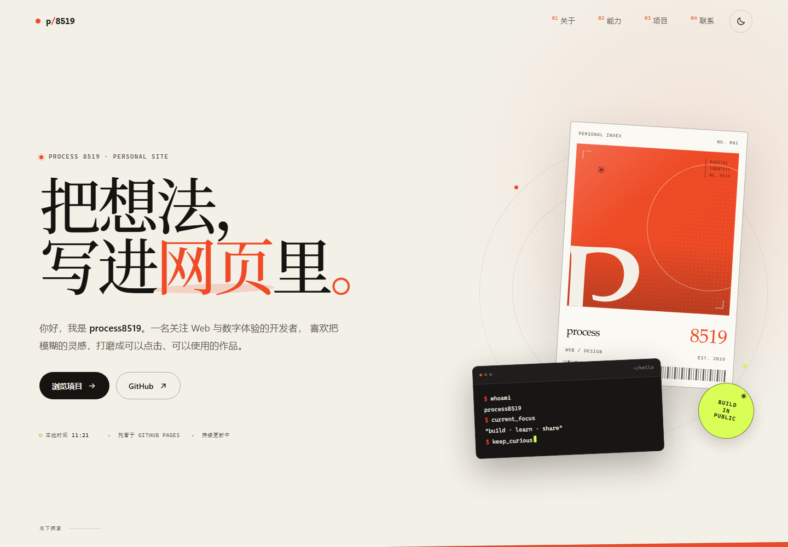

# process8519.github.io

process8519 的个人网站，使用原生 HTML、CSS 和 JavaScript 构建，托管于 GitHub Pages。

- 线上地址：<https://process8519.github.io/>
- 源码仓库：<https://github.com/process8519/process8519.github.io>



## 网站包含什么

- 单页个人主页：首页、关于、能力、项目、联系
- 完整响应式布局，手机 / 平板 / 桌面均可
- 明暗主题切换，自动跟随系统，并记住你的选择
- 滚动进度、入场动画、导航高亮、移动端菜单
- 无框架、无构建步骤、无第三方依赖，加载快，维护简单
- 语义化 HTML、键盘可访问、支持“减少动态效果”设置

## 文件结构

```text
.
├── index.html            # 页面内容
├── styles.css            # 所有样式与响应式规则
├── script.js             # 主题、动画、导航、时钟等交互
├── assets/
│   ├── avatar.png        # GitHub 头像
│   ├── favicon.svg       # 站点图标
│   └── preview.png       # README 首屏预览图
├── .nojekyll             # 告诉 GitHub Pages 不要用 Jekyll 处理
├── .gitignore
└── README.md
```

## 本地预览

在项目目录打开终端，运行：

```powershell
python -m http.server 8000
```

然后浏览器访问 <http://localhost:8000>。

> 不要直接双击 `index.html`。用本地服务器预览，路径和资源加载行为会更接近线上。

## 把网站改成你自己的

### 1. 基本信息

打开 `index.html`，搜索并替换：

- 标题与描述：`<title>`、`meta[name="description"]`、`og:*`
- 首屏文案：`<h1 class="hero-title">` 和 `.hero-lede`
- 自我介绍：`#about` 里的 `.about-copy`
- 能力标签：`#skills` 里的四张 `.skill-card`
- 项目内容：`#projects` 里的 `.featured-project` 和 `.project-card`
- 联系方式：`#contact` 里的按钮链接

### 2. 头像

替换 `assets/avatar.png` 即可，建议使用正方形图片（至少 420 × 420）。

### 3. 颜色

在 `styles.css` 顶部的 `:root` 中修改：

```css
--bg: #f3f0e8;       /* 页面背景 */
--ink: #151411;      /* 主要文字 */
--accent: #ef4b26;   /* 强调色 */
--lime: #d9ff57;     /* 点缀色 */
```

深色模式的颜色在同文件的 `[data-theme="dark"]` 中修改。

### 4. 项目卡片

复制一个 `<article class="project-card">`，修改标题、描述、标签和链接即可增加项目。
如果暂时没有更多项目，保留现在的“下一件作品 / 你的想法？”占位卡片也很好看。

## 上传到 GitHub

这个仓库已经和线上地址关联。每次修改后，只需把改动推送到 `main` 分支，GitHub Pages 会自动更新。

### 方式一：命令行（推荐）

```powershell
git status
git add -A
git commit -m "更新个人网站"
git push origin main
```

如果这是第一次在这台电脑上提交，先设置仓库级别的提交身份（不会影响其他项目）：

```powershell
git config user.name "process8519"
git config user.email "216992894+process8519@users.noreply.github.com"
```

推送时如果弹出 Git Credential Manager 窗口，选择 **Sign in with your browser**，在浏览器里确认 GitHub 账号即可。Windows 通常会把凭据安全保存，下次不用重复登录。

### 方式二：GitHub 网页上传

1. 打开 <https://github.com/process8519/process8519.github.io>
2. 点击 **Add file → Upload files**
3. 把 `index.html`、`styles.css`、`script.js` 和 `assets` 文件夹拖进去
4. 填写提交说明，点击 **Commit changes**
5. 等 1–2 分钟，访问 <https://process8519.github.io/>

> 网页上传时请保持目录结构：`assets/avatar.png` 必须仍在 `assets` 文件夹里。
> `.nojekyll` 是隐藏文件，Windows 资源管理器需要开启“显示隐藏的项目”才能看到；不上传它通常也能正常显示，但建议保留。

### 方式三：GitHub Desktop

安装 [GitHub Desktop](https://desktop.github.com/)，登录账号，选择 **Add existing repository** 指向本文件夹，然后：

1. 在左下角填写提交说明
2. 点击 **Commit to main**
3. 点击 **Push origin**

## 检查 GitHub Pages 设置

仓库已按用户主页仓库命名（`process8519.github.io`），通常无需再设置。如果页面 404：

1. 打开仓库的 **Settings → Pages**
2. **Build and deployment → Source** 选择 **Deploy from a branch**
3. 分支选择 **main**，目录选择 **/(root)**
4. 点击 **Save**
5. 在 **Actions** 或 **Pages** 中等待部署完成

首次部署或每次更新通常需要 1–3 分钟。若仍看到旧页面，按 `Ctrl + F5` 强制刷新，或换无痕窗口访问。

## 常见问题

**推送时报 `Authentication failed`**

在 Windows 的“凭据管理器 → Windows 凭据”中删除旧的 `git:https://github.com` 凭据，再执行 `git push origin main`，按提示用浏览器登录。

**页面显示 404**

确认仓库名是 `process8519.github.io`、默认分支是 `main`、根目录有 `index.html`，并且 Pages 的来源设置为 `main / (root)`。

**样式没有生效**

确认 `styles.css` 与 `index.html` 在同一级目录，文件名大小写完全一致。GitHub Pages 的路径区分大小写。

**想绑定自己的域名**

在仓库 **Settings → Pages → Custom domain** 填写域名，并按 GitHub 提示在域名服务商处添加 `CNAME` 记录。仓库根目录会自动生成 `CNAME` 文件，不要随意删除。

## 设计说明

- 字体：优先使用系统自带的衬线 / 无衬线字体，不依赖外部字体服务
- 图形：全部由 CSS 和 SVG 绘制，没有图片加载负担
- 主题：首次访问跟随系统，手动切换后保存在 `localStorage`
- 动效：尊重 `prefers-reduced-motion`，关闭动画的用户仍能正常阅读
- 兼容：支持现代 Chrome、Edge、Firefox、Safari

---

© process8519 · Handcrafted with HTML, CSS & JavaScript.
